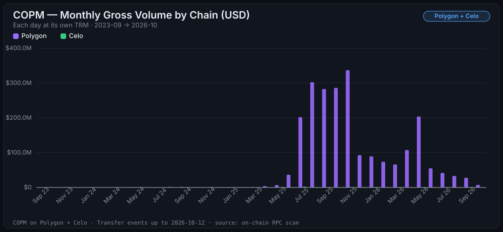
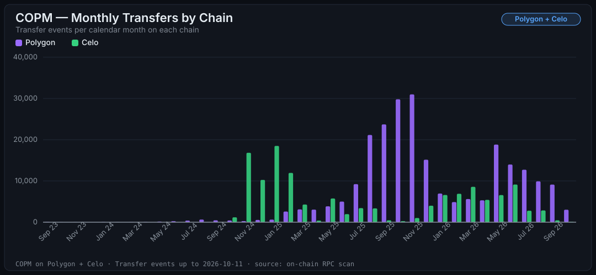
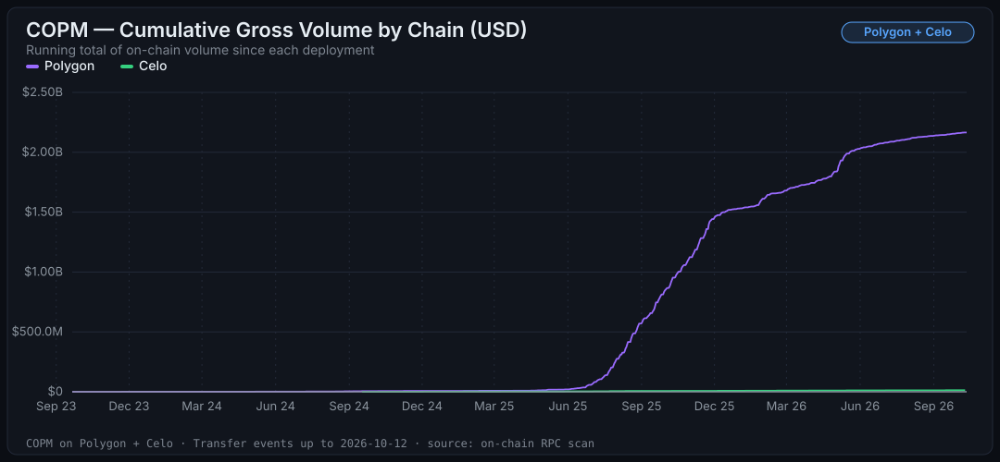
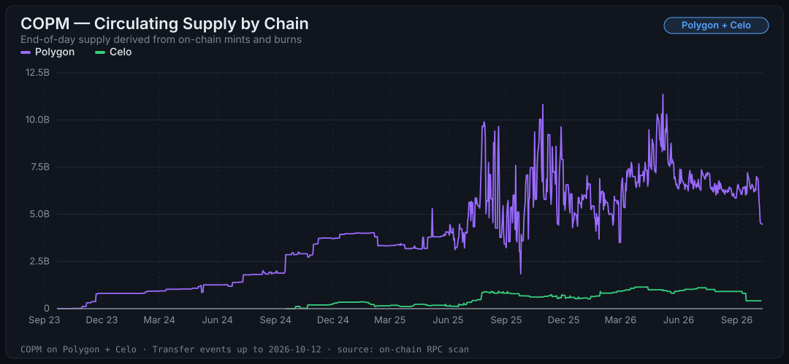

# COPM — Auditoría y análisis on-chain unificado (Polygon + Celo)

> La vista consolidada de COPM, la stablecoin de peso colombiano de [Minteo](https://minteo.com/), a través de sus dos deployments EVM: **Polygon** y **Celo**. Cada número sale de eventos `Transfer` leídos directamente de cada chain y verificados contra el estado on-chain en vivo.
>
> 🇬🇧 [English version](./AUDIT.md) · 📖 [Glosario](./GLOSSARY.es.md) · 🔔 [Eventos del contrato](./EVENTS.es.md)
>
> ¿Quieres el detalle de una sola chain? Cada una tiene su auditoría independiente: **[Polygon](./audit/polygon.es.md)** · **[Celo](./audit/celo.es.md)**

Datos al bloque <!-- copm:polygon.checkpointBlock -->95.370.448<!-- /copm --> de Polygon y al bloque <!-- copm:celo.checkpointBlock -->79.861.762<!-- /copm --> de Celo (<!-- copm:polygon.checkpointDate -->2026-10-11<!-- /copm -->). Cada cifra de esta página se completa desde `data/` con `npm run reports`.

## Los números, lado a lado

| Métrica | Polygon | Celo | **Total** |
| :--- | ---: | ---: | ---: |
| Deploy del contrato | <!-- copm:polygon.deployDate -->2023-09-19<!-- /copm --> | <!-- copm:celo.deployDate -->2024-09-11<!-- /copm --> | — |
| Días auditados | <!-- copm:polygon.totalDays -->1.117<!-- /copm --> | <!-- copm:celo.totalDays -->754<!-- /copm --> | — |
| Eventos `Transfer` | <!-- copm:polygon.transfers -->241.858<!-- /copm --> | <!-- copm:celo.transfers -->132.944<!-- /copm --> | **<!-- copm:combined.transfers -->374.802<!-- /copm -->** |
| Volumen bruto (USD) | <!-- copm:polygon.grossVolumeUsd -->US$2.165 millones<!-- /copm --> | <!-- copm:celo.grossVolumeUsd -->US$13 millones<!-- /copm --> | **~<!-- copm:combined.grossVolumeUsd -->US$2.178 millones<!-- /copm -->** |
| Volumen neto (USD) | <!-- copm:polygon.netVolumeUsd -->US$1.541 millones<!-- /copm --> | <!-- copm:celo.netVolumeUsd -->US$10,5 millones<!-- /copm --> | **<!-- copm:combined.netVolumeUsd -->US$1.551 millones<!-- /copm -->** |
| Ticket promedio | ~<!-- copm:polygon.avgTicketUsd -->US$8.952<!-- /copm --> | ~<!-- copm:celo.avgTicketUsd -->US$98<!-- /copm --> | — |
| Pico de transferencias/día | <!-- copm:polygon.peakTxCount -->2.597<!-- /copm --> (<!-- copm:polygon.peakTxDay -->2025-11-24<!-- /copm -->) | <!-- copm:celo.peakTxCount -->1.919<!-- /copm --> (<!-- copm:celo.peakTxDay -->2025-01-19<!-- /copm -->) | — |
| Pico de volumen/día | <!-- copm:polygon.peakVolumeUsd -->US$38,6 millones<!-- /copm --> (<!-- copm:polygon.peakVolumeDay -->2025-11-24<!-- /copm -->) | <!-- copm:celo.peakVolumeUsd -->US$737 mil<!-- /copm --> (<!-- copm:celo.peakVolumeDay -->2025-07-23<!-- /copm -->) | — |
| Mes pico (volumen) | <!-- copm:polygon.peakMonthUsd -->US$318,4 millones<!-- /copm --> (<!-- copm:polygon.peakMonthShort -->nov 2025<!-- /copm -->) | <!-- copm:celo.peakMonthUsd -->US$2,2 millones<!-- /copm --> (<!-- copm:celo.peakMonthShort -->jul 2025<!-- /copm -->) | — |
| Supply on-chain actual | <!-- copm:polygon.supplyCompact -->4.482 millones<!-- /copm --> COPM | <!-- copm:celo.supplyCompact -->418,6 millones<!-- /copm --> COPM | **<!-- copm:combined.supply -->4.901 millones<!-- /copm --> COPM ≈ <!-- copm:combined.supplyUsd -->US$1,2 millones<!-- /copm -->** |
| Holders con saldo | <!-- copm:polygon.holders -->582<!-- /copm --> | <!-- copm:celo.holders -->998<!-- /copm --> | **<!-- copm:combined.holders -->1.580<!-- /copm -->** |
| Reglas de validación estricta | <!-- copm:polygon.checksPassed -->17<!-- /copm -->/<!-- copm:polygon.checksTotal -->17<!-- /copm --> ✅ | <!-- copm:celo.checksPassed -->17<!-- /copm -->/<!-- copm:celo.checksTotal -->17<!-- /copm --> ✅ | **<!-- copm:combined.checksPassed -->34<!-- /copm -->/<!-- copm:combined.checksTotal -->34<!-- /copm --> ✅** |

> Tasa de cambio: 1 USD = <!-- copm:fx.copPerUsd -->4.000<!-- /copm --> COP, constante (±5% de margen). Misma metodología, mismos scripts, [mismas validaciones](#validación) en ambas chains.

---

## Una stablecoin, dos roles

Mira el ticket promedio: **<!-- copm:polygon.avgTicketUsd -->US$8.952<!-- /copm --> en Polygon, <!-- copm:celo.avgTicketUsd -->US$98<!-- /copm --> en Celo**. Esa diferencia de unos dos órdenes de magnitud no es ruido — es arquitectura.

Polygon es el rail institucional: settlement B2B, montos grandes, casi todo el volumen histórico. Celo es la red de pagos pequeños: remesas, micropagos, billeteras de usuario final — con un conteo de transferencias diarias del mismo orden que el de Polygon (~<!-- copm:celo.avgDailyTransfers -->176<!-- /copm --> vs ~<!-- copm:polygon.avgDailyTransfers -->217<!-- /copm -->), pero moviendo una fracción pequeña del valor.



## El relevo entre chains se ve a simple vista

El gráfico de transferencias mensuales cuenta una historia que ningún dashboard interno podría contar mejor: **Celo despegó primero en actividad** (su pico de <!-- copm:celo.peakTxMonthCount -->18.491<!-- /copm --> transferencias fue en <!-- copm:celo.peakTxMonth -->enero 2025<!-- /copm -->, apenas cuatro meses después del deploy), y **Polygon tomó el relevo** con la ola institucional de mediados-finales de 2025 que culminó en <!-- copm:polygon.peakMonth -->noviembre 2025<!-- /copm -->, su mes de mayor volumen.



También explica por qué la segunda chain despega más rápido: COPM tardó **16,5 meses** desde el despliegue en superar las 100 transferencias diarias en Polygon (primer día: <!-- copm:polygon.firstDayAbove100 -->2025-02-03<!-- /copm -->), y **7 semanas** desde el despliegue en lograrlo en Celo, unas 6 desde su primera transferencia (primer día: <!-- copm:celo.firstDayAbove100 -->2024-10-30<!-- /copm -->). La segunda chain no empieza de cero — hereda partners, operación y casos de uso ya probados.

## El acumulado: ~<!-- copm:combined.grossVolumeUsd -->US$2.178 millones<!-- /copm --> y subiendo



## El supply de cada chain, derivado evento por evento



En ambas chains, el supply derivado de reproducir cada evento `Transfer` (<!-- copm:polygon.transfers -->241.858<!-- /copm --> en Polygon, <!-- copm:celo.transfers -->132.944<!-- /copm --> en Celo) es igual al `totalSupply()` del contrato en vivo **al wei**: <!-- copm:polygon.supply -->4.482.231.674,75<!-- /copm --> COPM en Polygon y <!-- copm:celo.supply -->418.585.134,63<!-- /copm --> COPM en Celo. El supply de Polygon tuvo su máximo en <!-- copm:polygon.peakSupplyCopm -->11.363 millones<!-- /copm --> COPM el <!-- copm:polygon.peakSupplyDay -->2026-05-07<!-- /copm -->; el de Celo, en <!-- copm:celo.peakSupplyCopm -->1.145 millones<!-- /copm --> COPM el <!-- copm:celo.peakSupplyDay -->2026-03-24<!-- /copm -->.

Versiones anteriores de este dataset omitían parte del historial de Polygon y mostraban una diferencia contra `totalSupply()`. La validación estricta existe para que eso no vuelva a pasar: no tolera ninguna diferencia.

---

## Validación

Cada chain pasa las mismas <!-- copm:polygon.checksTotal -->17<!-- /copm --> reglas estrictas, offline y sin tolerancia: minted − burned es igual a `totalSupply()` al wei, reproducir las transferencias guardadas reproduce el checkpoint, ningún balance es negativo, `holders.csv` suma `totalSupply()`, las particiones están ordenadas y completas, los timestamps son exactos y `daily.csv` es exactamente lo que producen las transferencias. Resultado: **<!-- copm:combined.checksPassed -->34<!-- /copm -->/<!-- copm:combined.checksTotal -->34<!-- /copm --> en verde**.

La comparación con la chain en vivo ocurre cuando se escriben los datos, no en `validate`: `scan` reconcilia el libro contra `totalSupply()` en cada etapa antes de mover el checkpoint, y `holders` contrasta cada balance con `balanceOf` en el bloque del checkpoint.

| Chain | Reglas aprobadas | Detalle |
| :--- | :--- | :--- |
| Polygon | <!-- copm:polygon.checksPassed -->17<!-- /copm -->/<!-- copm:polygon.checksTotal -->17<!-- /copm --> ✅ | [`data/polygon/validation.json`](../data/polygon/validation.json) |
| Celo | <!-- copm:celo.checksPassed -->17<!-- /copm -->/<!-- copm:celo.checksTotal -->17<!-- /copm --> ✅ | [`data/celo/validation.json`](../data/celo/validation.json) |

## Por qué puedes confiar en estos números

1. **Fuente primaria.** Nada viene de dashboards, indexers ni APIs de terceros: solo llamadas RPC estándar contra cada chain. Sirve un RPC de pago o uno público.
2. **Reproducible.** Todo el pipeline está en este repositorio. `npm run audit:all` y obtienes los mismos números (más los eventos nuevos desde esta corrida).
3. **Verificado mientras corre.** El scan no avanza hasta que los eventos que tiene cuadran con el contrato, y cada número de estas páginas se completa desde los archivos de datos, nunca se escribe a mano.
4. **Público por definición.** La blockchain es un registro público: esta auditoría no usa — ni necesita — información interna de ninguna empresa.

## Reproduce todo

```bash
cp .env.example .env   # configura tus RPCs
npm install
npm run audit:all      # ambas chains + charts combinados + cifras de los reportes
```

Los detalles de metodología y limitaciones viven en cada auditoría individual: [Polygon](./audit/polygon.es.md) · [Celo](./audit/celo.es.md).
