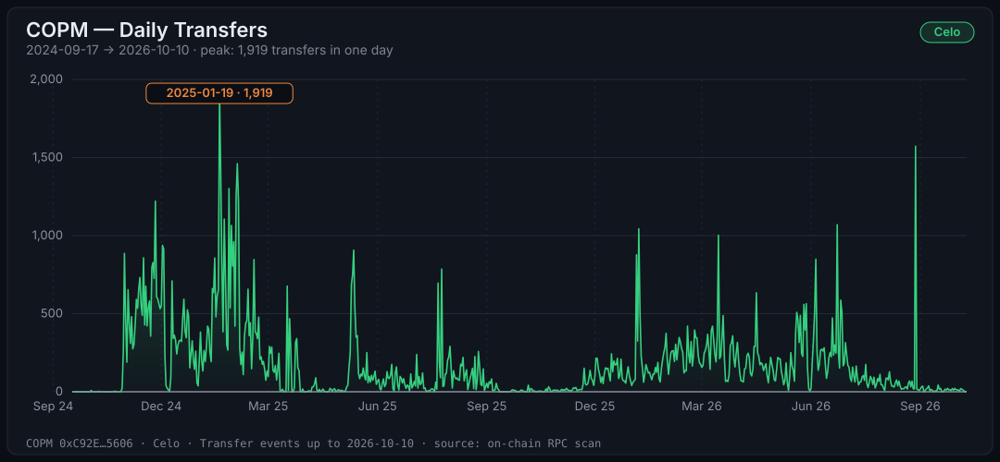
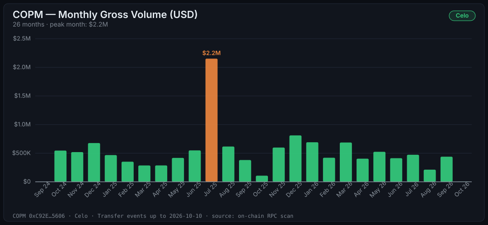
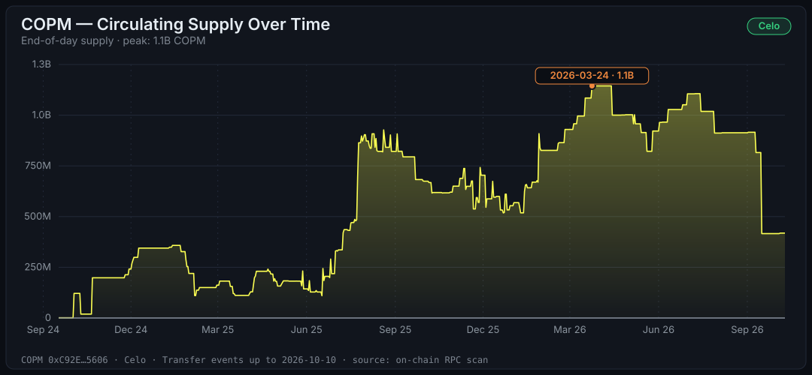
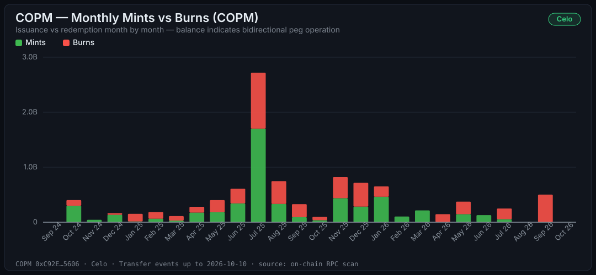
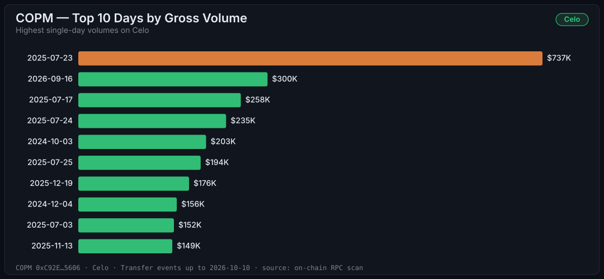

# COPM on Celo — On-chain Audit & Analysis

> On-chain audit of COPM on Celo: contract [`0xC92E8Fc2947E32F2B574CCA9F2F12097A71d5606`](https://celoscan.io/token/0xC92E8Fc2947E32F2B574CCA9F2F12097A71d5606) on Celo mainnet, every `Transfer` event from deploy to the checkpoint, verified against the live chain.
>
> 🇪🇸 [Versión en español](./celo.es.md) · 📖 [Glossary](../GLOSSARY.md) · 🔔 [Contract events](../EVENTS.md) · 🔗 [Unified Polygon + Celo audit](../AUDIT.md)

If COPM's story on [Polygon](./polygon.md) is that of an institutional rail, the Celo story is a completely different one — and seeing them side by side is where it gets interesting. Same stablecoin, two roles. Every figure below is filled from `data/celo/` by `npm run reports`; the checkpoint is block <!-- copm:celo.checkpointBlock -->79,861,762<!-- /copm --> (<!-- copm:celo.checkpointDate -->2026-10-11<!-- /copm -->).

## Executive summary

| Metric | Value |
| :--- | :--- |
| **Audited period** | <!-- copm:celo.firstDay -->2024-09-17<!-- /copm --> → <!-- copm:celo.lastDay -->2026-10-10<!-- /copm --> (<!-- copm:celo.totalDays -->754<!-- /copm --> days, ~<!-- copm:celo.years -->2.1<!-- /copm --> years) |
| **`Transfer` events** | **<!-- copm:celo.transfers -->132,944<!-- /copm -->** |
| **Gross volume moved** | <!-- copm:celo.grossVolumeCopm -->52.12B<!-- /copm --> COPM ≈ **<!-- copm:celo.grossVolumeUsd -->$13M<!-- /copm --> USD** |
| **Net volume** (excl. mints/burns) | <!-- copm:celo.netVolumeCopm -->41.97B<!-- /copm --> COPM ≈ **<!-- copm:celo.netVolumeUsd -->$10.5M<!-- /copm --> USD** |
| **Total issued (mints)** | <!-- copm:celo.minted -->5.28B<!-- /copm --> COPM ≈ <!-- copm:celo.mintedUsd -->$1.3M<!-- /copm --> USD |
| **Total redeemed (burns)** | <!-- copm:celo.burned -->4.86B<!-- /copm --> COPM ≈ <!-- copm:celo.burnedUsd -->$1.2M<!-- /copm --> USD |
| **Average ticket per transfer** | **~<!-- copm:celo.avgTicketUsd -->$98<!-- /copm --> USD** |
| **Daily average** | <!-- copm:celo.avgDailyTransfers -->176<!-- /copm --> transfers · <!-- copm:celo.avgDailyGrossUsd -->$17.3K<!-- /copm --> USD |
| **Peak transactions in one day** | **<!-- copm:celo.peakTxCount -->1,919<!-- /copm -->** (<!-- copm:celo.peakTxDay -->2025-01-19<!-- /copm -->) |
| **Peak volume in one day** | **<!-- copm:celo.peakVolumeUsd -->$737K<!-- /copm --> USD** (<!-- copm:celo.peakVolumeDay -->2025-07-23<!-- /copm -->) |
| **Peak month (volume)** | <!-- copm:celo.peakMonth -->July 2025<!-- /copm -->: <!-- copm:celo.peakMonthUsd -->$2.2M<!-- /copm --> USD |
| **Peak month (transactions)** | <!-- copm:celo.peakTxMonth -->January 2025<!-- /copm -->: <!-- copm:celo.peakTxMonthCount -->18,491<!-- /copm --> |
| **Supply peak** | <!-- copm:celo.peakSupplyCopm -->1.14B<!-- /copm --> COPM ≈ <!-- copm:celo.peakSupplyUsd -->$286K<!-- /copm --> USD (<!-- copm:celo.peakSupplyDay -->2026-03-24<!-- /copm -->) |
| **Current supply** | <!-- copm:celo.supply -->418,585,134.63<!-- /copm --> COPM ≈ <!-- copm:celo.supplyUsd -->$105K<!-- /copm --> USD |
| **Holders with a balance** | <!-- copm:celo.holders -->998<!-- /copm --> (the largest holds <!-- copm:celo.top1Pct -->76.2%<!-- /copm -->, the top 10 hold <!-- copm:celo.top10Pct -->98.8%<!-- /copm -->) |

> **FX rate:** 1 USD = <!-- copm:fx.copPerUsd -->4,000<!-- /copm --> COP, constant. ±5% margin depending on the day. Configurable when reproducing.

Unfamiliar with a term? It's in the [glossary](../GLOSSARY.md).

---

## The story the chain tells

### Same token, different movie: the average ticket here is <!-- copm:celo.avgTicketUsd -->$98<!-- /copm -->.

On Polygon, the average COPM transfer moves **~<!-- copm:polygon.avgTicketUsd -->$8,952<!-- /copm -->**. On Celo it moves **~<!-- copm:celo.avgTicketUsd -->$98<!-- /copm -->**. About two orders of magnitude apart.

The reading: Polygon carries the institutional settlement — large amounts, B2B partners. Celo carries small, frequent payments — the profile of remittances, micropayments, and end-user wallets. Both living under the same token is precisely the multi-chain design doing its job: each network serves the use case where it's strongest.



### On Polygon, takeoff took 17 months. On Celo, 6 weeks.

First day with transfers on Celo: <!-- copm:celo.firstDay -->2024-09-17<!-- /copm -->. First day above 100 transfers: **<!-- copm:celo.firstDayAbove100 -->2024-10-30<!-- /copm -->**.

The explanation is textbook: by the time COPM reached Celo, the operation, the partners, and the use case had already been proven on Polygon. A second chain doesn't start from zero — it inherits the first one's traction. And <!-- copm:celo.peakTxMonth -->January 2025<!-- /copm --> became its most active month ever: **<!-- copm:celo.peakTxMonthCount -->18,491<!-- /copm --> transactions**.

### The volume is small; the activity is not.

<!-- copm:celo.grossVolumeUsd -->$13M<!-- /copm --> gross over <!-- copm:celo.years -->2.1<!-- /copm --> years sounds tiny next to Polygon's <!-- copm:polygon.grossVolumeUsd -->$2.17B<!-- /copm --> — and it is. But the surprising number is a different one: **the average daily transaction count is of the same order on both chains** (~<!-- copm:celo.avgDailyTransfers -->176<!-- /copm -->/day on Celo vs ~<!-- copm:polygon.avgDailyTransfers -->217<!-- /copm -->/day on Polygon). Celo processes a steady flow of small operations: there was activity on <!-- copm:celo.activeDays -->688<!-- /copm --> of the <!-- copm:celo.totalDays -->754<!-- /copm --> audited days (<!-- copm:celo.activeDaysPct -->91%<!-- /copm -->).

Activity comes in waves, though. Recent months are quiet: <!-- copm:celo.month.2026-09.transfers -->448<!-- /copm --> transfers in September 2026 against <!-- copm:celo.month.2026-06.transfers -->9,135<!-- /copm --> in June 2026 and <!-- copm:celo.peakTxMonthCount -->18,491<!-- /copm --> in <!-- copm:celo.peakTxMonth -->January 2025<!-- /copm -->.



### <!-- copm:celo.peakMonth -->July 2025<!-- /copm -->: the volume peak.

**<!-- copm:celo.peakMonthUsd -->$2.2M<!-- /copm --> in one month**, with <!-- copm:celo.peakVolumeDay -->2025-07-23<!-- /copm --> moving **<!-- copm:celo.peakVolumeUsd -->$737K<!-- /copm --> in a single day** — the chain's all-time record. Unlike Polygon, where the busiest month and the highest-volume month are <!-- copm:polygon.peakTxMonth -->November 2025<!-- /copm --> and <!-- copm:polygon.peakMonth -->November 2025<!-- /copm -->, on Celo the peaks are decoupled: transactions peaked in <!-- copm:celo.peakTxMonth -->January 2025<!-- /copm -->, volume in <!-- copm:celo.peakMonth -->July 2025<!-- /copm -->. Another sign that the flows here respond to different dynamics.

### The supply reconciles exactly. To the wei.

Replaying the <!-- copm:celo.transfers -->132,944<!-- /copm --> events yields a derived supply of **<!-- copm:celo.supply -->418,585,134.63<!-- /copm --> COPM**. The contract's `totalSupply()` at the same block reports **<!-- copm:celo.supply -->418,585,134.63<!-- /copm --> COPM**.

**Difference: zero, to the wei.** Every mint and every burn in the contract's history on Celo is classified and reconciles against the on-chain state, and the <!-- copm:celo.holders -->998<!-- /copm --> balances add up to the same total. It's the perfect reconciliation an accountant would call "balanced books" — derived exclusively from public events. The supply peaked at <!-- copm:celo.peakSupplyCopm -->1.14B<!-- /copm --> COPM on <!-- copm:celo.peakSupplyDay -->2026-03-24<!-- /copm -->.



### Mints and burns: the peg operated bidirectionally here too.

- Total issued: **<!-- copm:celo.minted -->5.28B<!-- /copm --> COPM**
- Total redeemed: **<!-- copm:celo.burned -->4.86B<!-- /copm --> COPM** (<!-- copm:celo.burnedPct -->92.1%<!-- /copm --> of issuance)
- Difference: <!-- copm:celo.supplyCompact -->418.6M<!-- /copm --> COPM = exactly the current supply ✓



### Compliance actions: visible, and rare.

The `FREEZER_ROLE` can block an address; the contract emitted <!-- copm:celo.events.Frozen -->2<!-- /copm --> `Frozen`, <!-- copm:celo.events.Thawed -->1<!-- /copm --> `Thawed` and <!-- copm:celo.events.BurnedFrozen -->1<!-- /copm --> `BurnedFrozen` events in its whole history. Accounts frozen at the checkpoint: <!-- copm:celo.frozenAccounts -->1<!-- /copm -->. Polygon has <!-- copm:polygon.events.Frozen -->0<!-- /copm --> such events. The `Paused` event was emitted <!-- copm:polygon.events.Paused -->0<!-- /copm --> times on Polygon and <!-- copm:celo.events.Paused -->0<!-- /copm --> on Celo. [Why these events matter](../EVENTS.md).

---

## Top 10 days

### By transactions

| Day | Transfers | Gross volume |
| :--- | ---: | ---: |
| **<!-- copm:celo.topTx.1.day -->2025-01-19<!-- /copm -->** | **<!-- copm:celo.topTx.1.transfers -->1,919<!-- /copm -->** | <!-- copm:celo.topTx.1.usd -->$19.9K<!-- /copm --> |
| <!-- copm:celo.topTx.2.day -->2026-08-28<!-- /copm --> | <!-- copm:celo.topTx.2.transfers -->1,572<!-- /copm --> | <!-- copm:celo.topTx.2.usd -->$67K<!-- /copm --> |
| <!-- copm:celo.topTx.3.day -->2025-02-03<!-- /copm --> | <!-- copm:celo.topTx.3.transfers -->1,461<!-- /copm --> | <!-- copm:celo.topTx.3.usd -->$18.2K<!-- /copm --> |
| <!-- copm:celo.topTx.4.day -->2025-01-20<!-- /copm --> | <!-- copm:celo.topTx.4.transfers -->1,408<!-- /copm --> | <!-- copm:celo.topTx.4.usd -->$14.5K<!-- /copm --> |
| <!-- copm:celo.topTx.5.day -->2025-01-27<!-- /copm --> | <!-- copm:celo.topTx.5.transfers -->1,301<!-- /copm --> | <!-- copm:celo.topTx.5.usd -->$32.1K<!-- /copm --> |
| <!-- copm:celo.topTx.6.day -->2025-02-02<!-- /copm --> | <!-- copm:celo.topTx.6.transfers -->1,249<!-- /copm --> | <!-- copm:celo.topTx.6.usd -->$12.2K<!-- /copm --> |
| <!-- copm:celo.topTx.7.day -->2024-11-26<!-- /copm --> | <!-- copm:celo.topTx.7.transfers -->1,221<!-- /copm --> | <!-- copm:celo.topTx.7.usd -->$35.3K<!-- /copm --> |
| <!-- copm:celo.topTx.8.day -->2025-02-04<!-- /copm --> | <!-- copm:celo.topTx.8.transfers -->1,218<!-- /copm --> | <!-- copm:celo.topTx.8.usd -->$39.3K<!-- /copm --> |
| <!-- copm:celo.topTx.9.day -->2025-01-23<!-- /copm --> | <!-- copm:celo.topTx.9.transfers -->1,106<!-- /copm --> | <!-- copm:celo.topTx.9.usd -->$7.8K<!-- /copm --> |
| <!-- copm:celo.topTx.10.day -->2026-06-23<!-- /copm --> | <!-- copm:celo.topTx.10.transfers -->1,070<!-- /copm --> | <!-- copm:celo.topTx.10.usd -->$24.9K<!-- /copm --> |

### By volume

| Day | Gross volume | Transfers |
| :--- | ---: | ---: |
| **<!-- copm:celo.topVol.1.day -->2025-07-23<!-- /copm -->** | **<!-- copm:celo.topVol.1.usd -->$737K<!-- /copm -->** | <!-- copm:celo.topVol.1.transfers -->192<!-- /copm --> |
| <!-- copm:celo.topVol.2.day -->2026-09-16<!-- /copm --> | <!-- copm:celo.topVol.2.usd -->$300K<!-- /copm --> | <!-- copm:celo.topVol.2.transfers -->43<!-- /copm --> |
| <!-- copm:celo.topVol.3.day -->2025-07-17<!-- /copm --> | <!-- copm:celo.topVol.3.usd -->$258K<!-- /copm --> | <!-- copm:celo.topVol.3.transfers -->20<!-- /copm --> |
| <!-- copm:celo.topVol.4.day -->2025-07-24<!-- /copm --> | <!-- copm:celo.topVol.4.usd -->$235K<!-- /copm --> | <!-- copm:celo.topVol.4.transfers -->90<!-- /copm --> |
| <!-- copm:celo.topVol.5.day -->2024-10-03<!-- /copm --> | <!-- copm:celo.topVol.5.usd -->$203K<!-- /copm --> | <!-- copm:celo.topVol.5.transfers -->8<!-- /copm --> |
| <!-- copm:celo.topVol.6.day -->2025-07-25<!-- /copm --> | <!-- copm:celo.topVol.6.usd -->$194K<!-- /copm --> | <!-- copm:celo.topVol.6.transfers -->786<!-- /copm --> |
| <!-- copm:celo.topVol.7.day -->2025-12-19<!-- /copm --> | <!-- copm:celo.topVol.7.usd -->$176K<!-- /copm --> | <!-- copm:celo.topVol.7.transfers -->174<!-- /copm --> |
| <!-- copm:celo.topVol.8.day -->2024-12-04<!-- /copm --> | <!-- copm:celo.topVol.8.usd -->$156K<!-- /copm --> | <!-- copm:celo.topVol.8.transfers -->229<!-- /copm --> |
| <!-- copm:celo.topVol.9.day -->2025-07-03<!-- /copm --> | <!-- copm:celo.topVol.9.usd -->$152K<!-- /copm --> | <!-- copm:celo.topVol.9.transfers -->37<!-- /copm --> |
| <!-- copm:celo.topVol.10.day -->2025-11-13<!-- /copm --> | <!-- copm:celo.topVol.10.usd -->$149K<!-- /copm --> | <!-- copm:celo.topVol.10.transfers -->26<!-- /copm --> |



---

## Validation

The same <!-- copm:celo.checksTotal -->17<!-- /copm --> strict rules as Polygon, offline and with no tolerance, <!-- copm:celo.checksPassed -->17<!-- /copm --> passed (last run <!-- copm:celo.validatedDate -->2026-10-11<!-- /copm -->):

| # | Rule | Result |
| :--- | :--- | :--- |
| 1 | Event count: stored transfers equal the checkpoint | ✅ <!-- copm:celo.transfers -->132,944<!-- /copm --> = <!-- copm:celo.transfers -->132,944<!-- /copm --> |
| 2 | Supply: minted − burned equals `totalSupply()` at the checkpoint block | ✅ difference 0 wei |
| 3 | Replaying the stored transfers reproduces the checkpoint ledger | ✅ |
| 4 | No negative balance in the ledger | ✅ |
| 5 | `holders.csv` adds up to `totalSupply()`; every balance equals `balanceOf` | ✅ <!-- copm:celo.holders -->998<!-- /copm --> holders, <!-- copm:celo.addressesEverSeen -->3,123<!-- /copm --> addresses |
| 6 | Partitions strictly ordered, no duplicate (tx hash, log index) | ✅ |
| 7 | Every row sits in the partition of its UTC month | ✅ |
| 8 | Nothing above the checkpoint block | ✅ |
| 9 | Nothing before the deploy block | ✅ block <!-- copm:celo.deployBlock -->27,680,993<!-- /copm --> |
| 10 | Every transfer has an exact block timestamp | ✅ <!-- copm:celo.transfers -->132,944<!-- /copm --> events, 0 missing |
| 11 | Timestamps inside the deploy → checkpoint window | ✅ |
| 12 | Admin events strictly ordered, none above the checkpoint | ✅ |
| 13 | Admin event count equals the checkpoint | ✅ <!-- copm:celo.adminEvents -->12<!-- /copm --> events |
| 14 | `daily.csv` equals the series rebuilt from the ledger, ending at `totalSupply()` | ✅ |
| 15 | Daily series has the length announced in `summary.json` | ✅ <!-- copm:celo.totalDays -->754<!-- /copm --> days |
| 16 | Daily series is continuous (no missing day) | ✅ 0 gaps |
| 17 | `daily.csv` transfer total equals `summary.json` | ✅ |

As on Polygon, the comparison with the live chain happens when the data is written: `holders` checks every balance against `balanceOf` at the checkpoint block, and `scan` reconciles against `totalSupply()` before the checkpoint moves. Full results in [`data/celo/validation.json`](../../data/celo/validation.json).

---

## Methodology

Identical to [Polygon's](./polygon.md#methodology) — same pipeline, same scripts, only `CHAIN=celo` changes. One chain-specific detail: Celo produces blocks much faster than Polygon, especially after its migration to an L2, so the block range from deploy (block <!-- copm:celo.deployBlock -->27,680,993<!-- /copm -->) to the checkpoint is wide, and the public endpoint is the limiting factor (see below).

## Limitations

1. **Celo only.** Polygon is audited in [its own audit](./polygon.md); the consolidated view lives in the [unified audit](../AUDIT.md).
2. **Fixed rate of <!-- copm:fx.copPerUsd -->4,000<!-- /copm --> COP/USD.** ±5% margin.
3. **Internal addresses not filtered.** Same as Polygon.
4. **Provenance of the history.** The public Celo endpoint (`forno.celo.org`) answers `eth_getLogs` with empty arrays and no error for a large share of non-empty ranges, so a full-history scan could not finish there on 2026-10-11. The history up to block 79,856,063 was assembled from the union of seven scans plus the earlier dataset and certified with the same checks: supply equal to `totalSupply()` to the wei and every balance equal to `balanceOf`. Transfers are covered by that proof. The approval counters (<!-- copm:celo.approvals -->82,623<!-- /copm -->) are a lower bound. A scan from the deploy block against an archive endpoint (`scan --fresh --chain celo`) rebuilds the history from scratch.
5. **Transfers are not payments.** A single payment can emit several transfers, so the average ticket is a value per transfer, not per payment.

## Reproduce this audit

```bash
cp .env.example .env   # the public Celo RPC comes preconfigured
npm install
npm run audit:celo     # scan → holders → aggregate → charts → validate
npm run reports        # refresh the figures in the Markdown reports
```

From the committed checkpoint, a run takes seconds: only the blocks added since are scanned.
