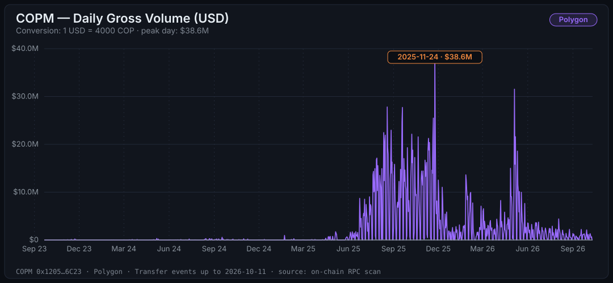
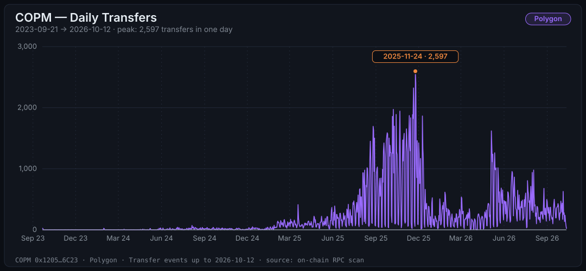
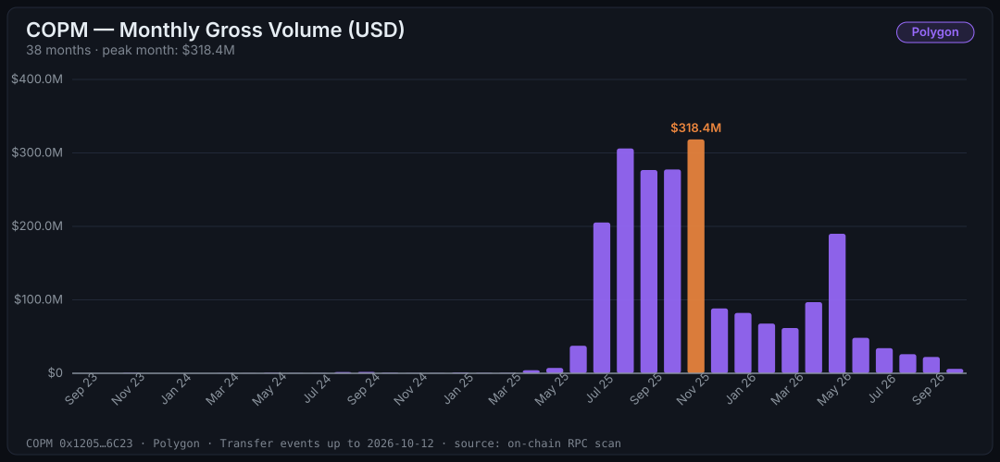
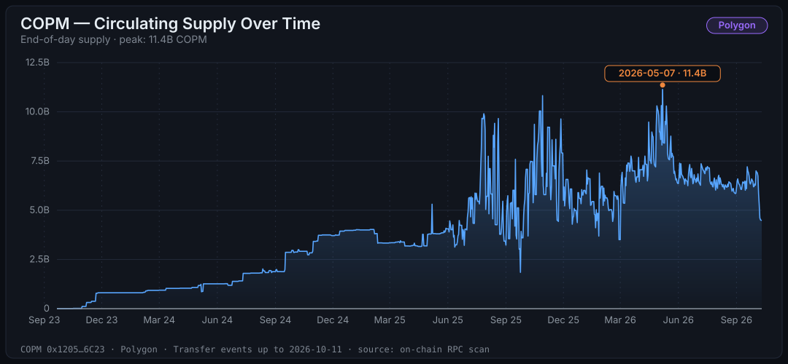
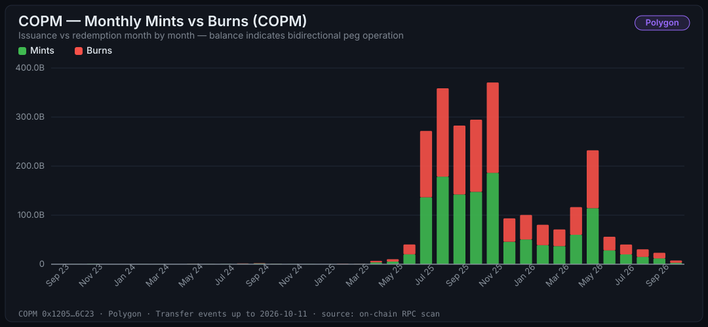
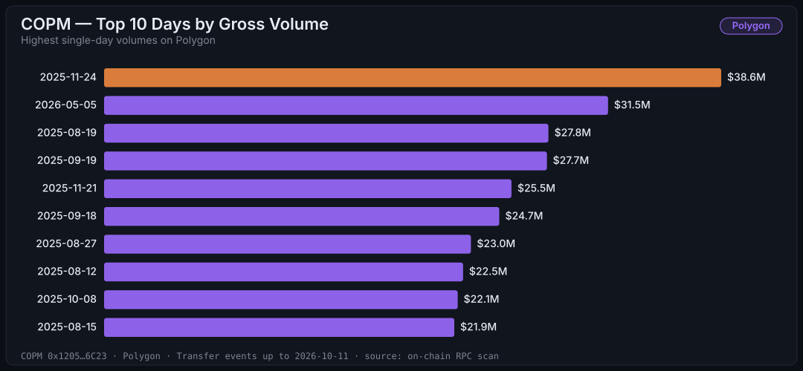

# COPM on Polygon — On-chain Audit & Analysis

> Full audit of contract [`0x12050c705152931cFEe3DD56c52Fb09Dea816C23`](https://polygonscan.com/token/0x12050c705152931cFEe3DD56c52Fb09Dea816C23) on Polygon mainnet: every `Transfer` event from the deploy block to the checkpoint, verified against the live chain.
>
> 🇪🇸 [Versión en español](./polygon.es.md) · 📖 [Glossary](../GLOSSARY.md) · 🔔 [Contract events](../EVENTS.md) · 🔗 [Unified Polygon + Celo audit](../AUDIT.md)

The data in this document doesn't come from a dashboard or a third party. It comes from the blockchain, event by event, using the scripts in this very repository. Anyone can reproduce every number. Every figure below is filled from `data/polygon/` by `npm run reports`; the checkpoint is block <!-- copm:polygon.checkpointBlock -->95,370,448<!-- /copm --> (<!-- copm:polygon.checkpointDate -->2026-10-11<!-- /copm -->).

## Executive summary

| Metric | Value |
| :--- | :--- |
| **Audited period** | <!-- copm:polygon.firstDay -->2023-09-21<!-- /copm --> → <!-- copm:polygon.lastDay -->2026-10-11<!-- /copm --> (<!-- copm:polygon.totalDays -->1,117<!-- /copm --> days, ~<!-- copm:polygon.years -->3.1<!-- /copm --> years) |
| **`Transfer` events** | **<!-- copm:polygon.transfers -->241,858<!-- /copm -->** |
| **Gross volume moved** | <!-- copm:polygon.grossVolumeCopm -->8.661T<!-- /copm --> COPM ≈ **<!-- copm:polygon.grossVolumeUsd -->$2.17B<!-- /copm --> USD** |
| **Net volume** (excl. mints/burns) | <!-- copm:polygon.netVolumeCopm -->6.164T<!-- /copm --> COPM ≈ **<!-- copm:polygon.netVolumeUsd -->$1.54B<!-- /copm --> USD** |
| **Total issued (mints)** | <!-- copm:polygon.minted -->1.251T<!-- /copm --> COPM ≈ <!-- copm:polygon.mintedUsd -->$312.7M<!-- /copm --> USD |
| **Total redeemed (burns)** | <!-- copm:polygon.burned -->1.246T<!-- /copm --> COPM ≈ <!-- copm:polygon.burnedUsd -->$311.5M<!-- /copm --> USD |
| **Daily average** | <!-- copm:polygon.avgDailyTransfers -->217<!-- /copm --> transfers · <!-- copm:polygon.avgDailyGrossUsd -->$1.9M<!-- /copm --> USD |
| **Average ticket per transfer** | ~<!-- copm:polygon.avgTicketUsd -->$8,952<!-- /copm --> USD |
| **Peak transactions in one day** | **<!-- copm:polygon.peakTxCount -->2,597<!-- /copm -->** (<!-- copm:polygon.peakTxDay -->2025-11-24<!-- /copm -->) |
| **Peak volume in one day** | **<!-- copm:polygon.peakVolumeUsd -->$38.6M<!-- /copm --> USD** (<!-- copm:polygon.peakVolumeDay -->2025-11-24<!-- /copm -->) |
| **Peak month** | **<!-- copm:polygon.peakMonth -->November 2025<!-- /copm -->: <!-- copm:polygon.peakMonthUsd -->$318.4M<!-- /copm --> USD** |
| **Supply peak** | <!-- copm:polygon.peakSupplyCopm -->11.36B<!-- /copm --> COPM ≈ <!-- copm:polygon.peakSupplyUsd -->$2.8M<!-- /copm --> USD (<!-- copm:polygon.peakSupplyDay -->2026-05-07<!-- /copm -->) |
| **Current supply** | <!-- copm:polygon.supply -->4,482,231,674.75<!-- /copm --> COPM ≈ <!-- copm:polygon.supplyUsd -->$1.1M<!-- /copm --> USD |
| **Holders with a balance** | <!-- copm:polygon.holders -->582<!-- /copm --> (the largest holds <!-- copm:polygon.top1Pct -->65.6%<!-- /copm -->, the top 10 hold <!-- copm:polygon.top10Pct -->95.5%<!-- /copm -->) |

> **FX rate:** 1 USD = <!-- copm:fx.copPerUsd -->4,000<!-- /copm --> COP, constant. The real rate moved over the period, so USD figures carry a ±5% margin. Configurable when reproducing.

Unfamiliar with a term? It's in the [glossary](../GLOSSARY.md).

---

## The story the chain tells

### Over <!-- copm:polygon.grossVolumeUsd -->$2.17B<!-- /copm --> moved. No pause, ever.

<!-- copm:polygon.grossVolumeCopm -->8.661T<!-- /copm --> COPM changed hands in <!-- copm:polygon.totalDays -->1,117<!-- /copm --> days: **~<!-- copm:polygon.grossVolumeUsd -->$2.17B<!-- /copm --> USD** gross, **<!-- copm:polygon.netVolumeUsd -->$1.54B<!-- /copm -->** net between wallets. The `PAUSER_ROLE` can stop every transfer; its `Paused` event was emitted <!-- copm:polygon.events.Paused -->0<!-- /copm --> times. There was activity on <!-- copm:polygon.activeDays -->910<!-- /copm --> of the <!-- copm:polygon.totalDays -->1,117<!-- /copm --> audited days (<!-- copm:polygon.activeDaysPct -->81%<!-- /copm -->).



### The token existed for 17 months before crossing 100 transactions per day.

Deploy: <!-- copm:polygon.deployDate -->2023-09-19<!-- /copm -->. First day above 100 transfers: **<!-- copm:polygon.firstDayAbove100 -->2025-02-03<!-- /copm -->**.

That gap tells you how a B2B settlement layer scales: not through retail user acquisition, but through large integrations. Each new partner is a step, not a slope. The early months were testing; the real takeoff came when integrations hit production — and from there the curve is a different animal.



### <!-- copm:polygon.peakMonth -->November 2025<!-- /copm -->: the month that changed everything.

**<!-- copm:polygon.peakMonthUsd -->$318.4M<!-- /copm --> USD in a single month. <!-- copm:polygon.peakMonthTransfers -->30,983<!-- /copm --> transactions.** The record day for activity is <!-- copm:polygon.peakTxDay -->2025-11-24<!-- /copm -->: **<!-- copm:polygon.topTx.1.usd -->$38.6M<!-- /copm -->** across **<!-- copm:polygon.peakTxCount -->2,597<!-- /copm --> transactions**. The record day for volume is <!-- copm:polygon.peakVolumeDay -->2025-11-24<!-- /copm -->, with **<!-- copm:polygon.peakVolumeUsd -->$38.6M<!-- /copm -->**.

Nearly all of the 10 highest-transaction days in the token's entire history happened between October and November 2025 (see the table below). That's not noise: it's the signature of a major integration or a new use case entering production.



### After the peak, activity fell back, rebounded once in May 2026, and has been shrinking since.

Monthly gross volume, from the peak on:

| Month | Gross volume | Transfers |
| :--- | ---: | ---: |
| <!-- copm:polygon.peakMonth -->November 2025<!-- /copm --> (peak) | <!-- copm:polygon.month.2025-11.usd -->$318.4M<!-- /copm --> | <!-- copm:polygon.month.2025-11.transfers -->30,983<!-- /copm --> |
| December 2025 | <!-- copm:polygon.month.2025-12.usd -->$88.3M<!-- /copm --> | <!-- copm:polygon.month.2025-12.transfers -->15,140<!-- /copm --> |
| January 2026 | <!-- copm:polygon.month.2026-01.usd -->$82.1M<!-- /copm --> | <!-- copm:polygon.month.2026-01.transfers -->6,950<!-- /copm --> |
| February 2026 | <!-- copm:polygon.month.2026-02.usd -->$67.7M<!-- /copm --> | <!-- copm:polygon.month.2026-02.transfers -->4,884<!-- /copm --> |
| March 2026 | <!-- copm:polygon.month.2026-03.usd -->$61.7M<!-- /copm --> | <!-- copm:polygon.month.2026-03.transfers -->5,616<!-- /copm --> |
| April 2026 | <!-- copm:polygon.month.2026-04.usd -->$96.9M<!-- /copm --> | <!-- copm:polygon.month.2026-04.transfers -->5,309<!-- /copm --> |
| May 2026 (rebound) | <!-- copm:polygon.month.2026-05.usd -->$189.9M<!-- /copm --> | <!-- copm:polygon.month.2026-05.transfers -->18,813<!-- /copm --> |
| June 2026 | <!-- copm:polygon.month.2026-06.usd -->$48.3M<!-- /copm --> | <!-- copm:polygon.month.2026-06.transfers -->13,985<!-- /copm --> |
| July 2026 | <!-- copm:polygon.month.2026-07.usd -->$34.3M<!-- /copm --> | <!-- copm:polygon.month.2026-07.transfers -->12,717<!-- /copm --> |
| August 2026 | <!-- copm:polygon.month.2026-08.usd -->$26.1M<!-- /copm --> | <!-- copm:polygon.month.2026-08.transfers -->9,913<!-- /copm --> |
| September 2026 | <!-- copm:polygon.month.2026-09.usd -->$22.3M<!-- /copm --> | <!-- copm:polygon.month.2026-09.transfers -->9,118<!-- /copm --> |
| October 2026 (to <!-- copm:polygon.lastDay -->2026-10-11<!-- /copm -->) | <!-- copm:polygon.month.2026-10.usd -->$6M<!-- /copm --> | <!-- copm:polygon.month.2026-10.transfers -->3,023<!-- /copm --> |

Volume settled between December and April, jumped in May 2026, and has declined every month since. The second-highest volume day in the token's history, **<!-- copm:polygon.topVol.2.day -->2026-05-05<!-- /copm -->** (<!-- copm:polygon.topVol.2.usd -->$31.5M<!-- /copm -->), belongs to that rebound. The supply followed: it peaked at <!-- copm:polygon.peakSupplyCopm -->11.36B<!-- /copm --> COPM on <!-- copm:polygon.peakSupplyDay -->2026-05-07<!-- /copm --> and stands at <!-- copm:polygon.supplyCompact -->4.48B<!-- /copm --> COPM at the checkpoint.

| Window | Gross volume |
| :--- | :--- |
| <!-- copm:polygon.peakMonth -->November 2025<!-- /copm --> (peak month) | <!-- copm:polygon.peakMonthUsd -->$318.4M<!-- /copm --> |
| Last 90 days | <!-- copm:polygon.last90GrossUsd -->$76.1M<!-- /copm --> |
| Last 30 days | <!-- copm:polygon.last30GrossUsd -->$21.2M<!-- /copm --> |

### Supply turns over ~<!-- copm:polygon.turnoverMonthly -->13.7<!-- /copm --> times a month. That's a payment rail, not a vault.

- Average supply (last 30 days): ~<!-- copm:polygon.last30AvgSupply -->6.21B<!-- /copm --> COPM
- Gross volume (last 30 days): ~<!-- copm:polygon.last30GrossUsd -->$21.2M<!-- /copm --> ≈ <!-- copm:polygon.last30GrossCopm -->84.93B<!-- /copm --> COPM
- **Implied turnover: ~<!-- copm:polygon.turnoverMonthly -->13.7<!-- /copm -->x per month, ~<!-- copm:polygon.turnoverYearly -->164<!-- /copm -->x per year**

For reference: USDT and USDC turn over on the order of 10–20x **per year**. COPM rotates its supply roughly an order of magnitude faster than that range. The reading is direct: nobody holds COPM for long — the average COPM changes hands ~<!-- copm:polygon.turnoverYearly -->164<!-- /copm --> times a year. That is the behavior of a *settlement rail*, not a store of value.



### Mints and burns nearly mirror each other: the peg operated in both directions.

- Total issued over <!-- copm:polygon.years -->3.1<!-- /copm --> years: **<!-- copm:polygon.minted -->1.251T<!-- /copm --> COPM**
- Total redeemed: **<!-- copm:polygon.burned -->1.246T<!-- /copm --> COPM** (<!-- copm:polygon.burnedPct -->99.6%<!-- /copm --> of issuance)
- Difference: <!-- copm:polygon.supplyCompact -->4.48B<!-- /copm --> COPM = exactly the current supply, to the wei ✓

Why does this matter? Because a burn is someone converting COPM back into pesos. If burns were much smaller than mints, that would be a red flag: tokens being issued but not redeemable. The near 1:1 balance sustained over years is the on-chain evidence of a peg with fluid bidirectional operation.



### Who holds it: a handful of addresses.

At the checkpoint, <!-- copm:polygon.holders -->582<!-- /copm --> addresses hold a balance (of <!-- copm:polygon.addressesEverSeen -->2,555<!-- /copm --> that ever touched the token). The largest holds <!-- copm:polygon.top1Pct -->65.6%<!-- /copm --> of the supply and the top 10 hold <!-- copm:polygon.top10Pct -->95.5%<!-- /copm -->. <!-- copm:polygon.contracts -->244<!-- /copm --> of the holders are contracts, not wallets. The full table is in `data/polygon/holders.csv`.

### Governance: who holds the roles.

The six roles (`DEFAULT_ADMIN_ROLE`, `MINTER_ROLE`, `PAUSER_ROLE`, `UPGRADER_ROLE`, `FREEZER_ROLE`, `RESCUER_ROLE`) can be granted to any address. Distinct addresses holding at least one of them today: <!-- copm:polygon.roleHolders -->1<!-- /copm -->. The proxy emitted <!-- copm:polygon.events.Upgraded -->2<!-- /copm --> `Upgraded` events (the first sets the initial implementation at deployment). See [which events matter](../EVENTS.md) for how to follow these changes.

---

## Top 10 days

### By transactions

| Day | Transfers | Gross volume |
| :--- | ---: | ---: |
| **<!-- copm:polygon.topTx.1.day -->2025-11-24<!-- /copm -->** | **<!-- copm:polygon.topTx.1.transfers -->2,597<!-- /copm -->** | <!-- copm:polygon.topTx.1.usd -->$38.6M<!-- /copm --> |
| <!-- copm:polygon.topTx.2.day -->2025-11-25<!-- /copm --> | <!-- copm:polygon.topTx.2.transfers -->2,404<!-- /copm --> | <!-- copm:polygon.topTx.2.usd -->$21.8M<!-- /copm --> |
| <!-- copm:polygon.topTx.3.day -->2025-11-20<!-- /copm --> | <!-- copm:polygon.topTx.3.transfers -->2,323<!-- /copm --> | <!-- copm:polygon.topTx.3.usd -->$21.5M<!-- /copm --> |
| <!-- copm:polygon.topTx.4.day -->2025-10-08<!-- /copm --> | <!-- copm:polygon.topTx.4.transfers -->1,972<!-- /copm --> | <!-- copm:polygon.topTx.4.usd -->$22.1M<!-- /copm --> |
| <!-- copm:polygon.topTx.5.day -->2025-11-21<!-- /copm --> | <!-- copm:polygon.topTx.5.transfers -->1,959<!-- /copm --> | <!-- copm:polygon.topTx.5.usd -->$25.5M<!-- /copm --> |
| <!-- copm:polygon.topTx.6.day -->2025-10-22<!-- /copm --> | <!-- copm:polygon.topTx.6.transfers -->1,944<!-- /copm --> | <!-- copm:polygon.topTx.6.usd -->$12.8M<!-- /copm --> |
| <!-- copm:polygon.topTx.7.day -->2025-10-14<!-- /copm --> | <!-- copm:polygon.topTx.7.transfers -->1,889<!-- /copm --> | <!-- copm:polygon.topTx.7.usd -->$17.3M<!-- /copm --> |
| <!-- copm:polygon.topTx.8.day -->2025-11-18<!-- /copm --> | <!-- copm:polygon.topTx.8.transfers -->1,885<!-- /copm --> | <!-- copm:polygon.topTx.8.usd -->$14.6M<!-- /copm --> |
| <!-- copm:polygon.topTx.9.day -->2025-11-11<!-- /copm --> | <!-- copm:polygon.topTx.9.transfers -->1,871<!-- /copm --> | <!-- copm:polygon.topTx.9.usd -->$21.3M<!-- /copm --> |
| <!-- copm:polygon.topTx.10.day -->2025-12-09<!-- /copm --> | <!-- copm:polygon.topTx.10.transfers -->1,864<!-- /copm --> | <!-- copm:polygon.topTx.10.usd -->$11M<!-- /copm --> |

### By volume

| Day | Gross volume | Transfers |
| :--- | ---: | ---: |
| **<!-- copm:polygon.topVol.1.day -->2025-11-24<!-- /copm -->** | **<!-- copm:polygon.topVol.1.usd -->$38.6M<!-- /copm -->** | <!-- copm:polygon.topVol.1.transfers -->2,597<!-- /copm --> |
| <!-- copm:polygon.topVol.2.day -->2026-05-05<!-- /copm --> | <!-- copm:polygon.topVol.2.usd -->$31.5M<!-- /copm --> | <!-- copm:polygon.topVol.2.transfers -->1,620<!-- /copm --> |
| <!-- copm:polygon.topVol.3.day -->2025-08-19<!-- /copm --> | <!-- copm:polygon.topVol.3.usd -->$27.8M<!-- /copm --> | <!-- copm:polygon.topVol.3.transfers -->1,155<!-- /copm --> |
| <!-- copm:polygon.topVol.4.day -->2025-09-19<!-- /copm --> | <!-- copm:polygon.topVol.4.usd -->$27.7M<!-- /copm --> | <!-- copm:polygon.topVol.4.transfers -->1,202<!-- /copm --> |
| <!-- copm:polygon.topVol.5.day -->2025-11-21<!-- /copm --> | <!-- copm:polygon.topVol.5.usd -->$25.5M<!-- /copm --> | <!-- copm:polygon.topVol.5.transfers -->1,959<!-- /copm --> |
| <!-- copm:polygon.topVol.6.day -->2025-09-18<!-- /copm --> | <!-- copm:polygon.topVol.6.usd -->$24.7M<!-- /copm --> | <!-- copm:polygon.topVol.6.transfers -->1,422<!-- /copm --> |
| <!-- copm:polygon.topVol.7.day -->2025-08-27<!-- /copm --> | <!-- copm:polygon.topVol.7.usd -->$23M<!-- /copm --> | <!-- copm:polygon.topVol.7.transfers -->1,629<!-- /copm --> |
| <!-- copm:polygon.topVol.8.day -->2025-08-12<!-- /copm --> | <!-- copm:polygon.topVol.8.usd -->$22.5M<!-- /copm --> | <!-- copm:polygon.topVol.8.transfers -->702<!-- /copm --> |
| <!-- copm:polygon.topVol.9.day -->2025-10-08<!-- /copm --> | <!-- copm:polygon.topVol.9.usd -->$22.1M<!-- /copm --> | <!-- copm:polygon.topVol.9.transfers -->1,972<!-- /copm --> |
| <!-- copm:polygon.topVol.10.day -->2025-08-15<!-- /copm --> | <!-- copm:polygon.topVol.10.usd -->$21.9M<!-- /copm --> | <!-- copm:polygon.topVol.10.transfers -->796<!-- /copm --> |



---

## Validation

No number in this audit is reported unverified. The validation step ([`pipeline/steps/validate.js`](../../pipeline/steps/validate.js)) is strict and offline, runs <!-- copm:polygon.checksTotal -->17<!-- /copm --> rules with no tolerance, and <!-- copm:polygon.checksPassed -->17<!-- /copm --> passed (last run <!-- copm:polygon.validatedDate -->2026-10-12<!-- /copm -->):

| # | Rule | Result |
| :--- | :--- | :--- |
| 1 | Event count: stored transfers equal the checkpoint | ✅ <!-- copm:polygon.transfers -->241,858<!-- /copm --> = <!-- copm:polygon.transfers -->241,858<!-- /copm --> |
| 2 | Supply: minted − burned equals `totalSupply()` at the checkpoint block | ✅ difference 0 wei |
| 3 | Replaying the stored transfers reproduces the checkpoint ledger | ✅ |
| 4 | No negative balance in the ledger | ✅ |
| 5 | `holders.csv` adds up to `totalSupply()`; every balance equals `balanceOf` | ✅ <!-- copm:polygon.holders -->582<!-- /copm --> holders, <!-- copm:polygon.addressesEverSeen -->2,555<!-- /copm --> addresses |
| 6 | Partitions strictly ordered, no duplicate (tx hash, log index) | ✅ |
| 7 | Every row sits in the partition of its UTC month | ✅ |
| 8 | Nothing above the checkpoint block | ✅ |
| 9 | Nothing before the deploy block | ✅ block <!-- copm:polygon.deployBlock -->47,747,145<!-- /copm --> |
| 10 | Every transfer has an exact block timestamp | ✅ <!-- copm:polygon.transfers -->241,858<!-- /copm --> events, 0 missing |
| 11 | Timestamps inside the deploy → checkpoint window | ✅ |
| 12 | Admin events strictly ordered, none above the checkpoint | ✅ |
| 13 | Admin event count equals the checkpoint | ✅ <!-- copm:polygon.adminEvents -->11<!-- /copm --> events |
| 14 | `daily.csv` equals the series rebuilt from the ledger, ending at `totalSupply()` | ✅ |
| 15 | Daily series has the length announced in `summary.json` | ✅ <!-- copm:polygon.totalDays -->1,117<!-- /copm --> days |
| 16 | Daily series is continuous (no missing day) | ✅ 0 gaps |
| 17 | `daily.csv` transfer total equals `summary.json` | ✅ |

The comparison with the live chain happens when the data is written: `scan` reconciles minted − burned against `totalSupply()` at the end of every stage before the checkpoint moves, and `holders` checks every address's balance against `balanceOf` at the checkpoint block. Full results in [`data/polygon/validation.json`](../../data/polygon/validation.json).

---

## Methodology

The pipeline is a handful of steps, each a command of `node pipeline/cli.js`, with no dependency beyond [viem](https://viem.sh):

1. **Discover** — finds the deploy block (block <!-- copm:polygon.deployBlock -->47,747,145<!-- /copm -->) by binary search over `eth_getCode` and reads the token metadata.
2. **Scan** — downloads every event of the contract with `eth_getLogs` in stages, with a canary and a head check in every batch, confirmation of empty ranges, and an exact reconciliation against `totalSupply()` before the checkpoint advances. Transfers are stored by month with their exact block timestamp; approvals are counted per day and per spender.
3. **Holders** — computes every balance from the ledger and checks each one against `balanceOf` at the checkpoint block.
4. **Aggregate** — replays the events in order and builds the daily series: volume, mints, burns, derived supply.
5. **Charts** — renders the SVGs with no canvas and no headless browser.
6. **Validate** — the <!-- copm:polygon.checksTotal -->17<!-- /copm --> strict rules above.
7. **Reports** — fills every figure of these documents from the data.

**Single source: one RPC endpoint.** No indexers, no third-party APIs, no explorers. Any provider works — a paid one (faster) or a public one (free, with rate limits the scanner handles on its own).

## Limitations

1. **Polygon only.** Celo activity is audited separately in [its own audit](./celo.md), and both are consolidated in the [unified audit](../AUDIT.md).
2. **Fixed rate of <!-- copm:fx.copPerUsd -->4,000<!-- /copm --> COP/USD.** ±5% margin on USD figures depending on the day.
3. **Internal addresses not filtered.** "Net" volume excludes mints and burns but doesn't distinguish movements between the issuer's corporate wallets.
4. **Addresses are not entities.** <!-- copm:polygon.contracts -->244<!-- /copm --> of the <!-- copm:polygon.holders -->582<!-- /copm --> holders are contracts, and one entity can control several wallets, so the concentration figures describe addresses, not owners.
5. **Transfers are not payments.** A single payment can emit several transfers (through a router, for example), so gross volume and transfer counts measure on-chain movement, not the number of payments.
6. **An earlier dataset was wrong.** Versions of this repository before the verified scan were missing part of Polygon's history and showed a gap against `totalSupply()`. The scan now reconciles to the wei at every stage and the validation tolerates no difference.

## Reproduce this audit

```bash
cp .env.example .env   # configure your Polygon RPC
npm install
npm run audit:polygon  # scan → holders → aggregate → charts → validate
npm run reports        # refresh the figures in the Markdown reports
```

On a normal machine with a paid RPC, a first scan from the deploy block takes on the order of ten minutes; later runs only scan the blocks added since the checkpoint. With a public RPC: slower, but it gets there. Every step can be re-run independently (`CHAIN=polygon npm run scan`, etc.).
